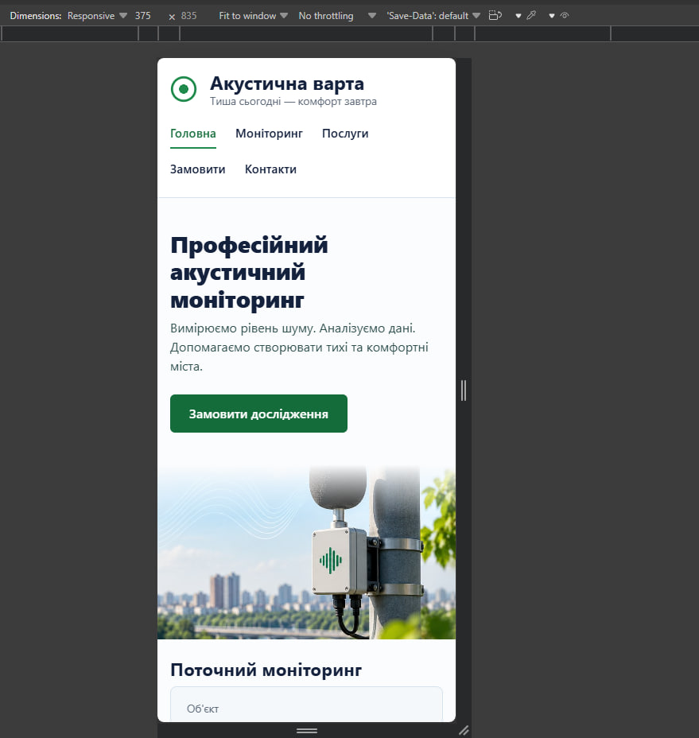
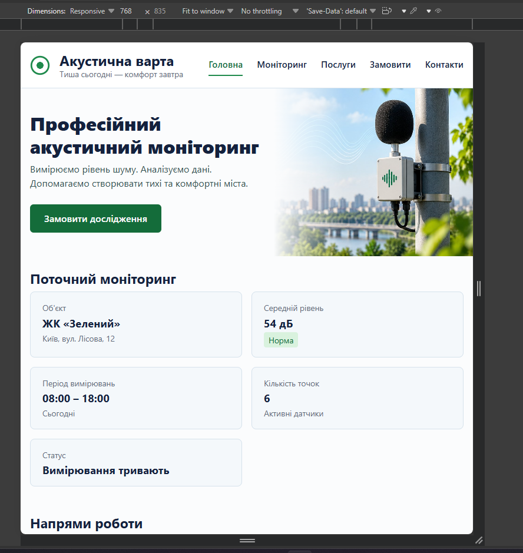
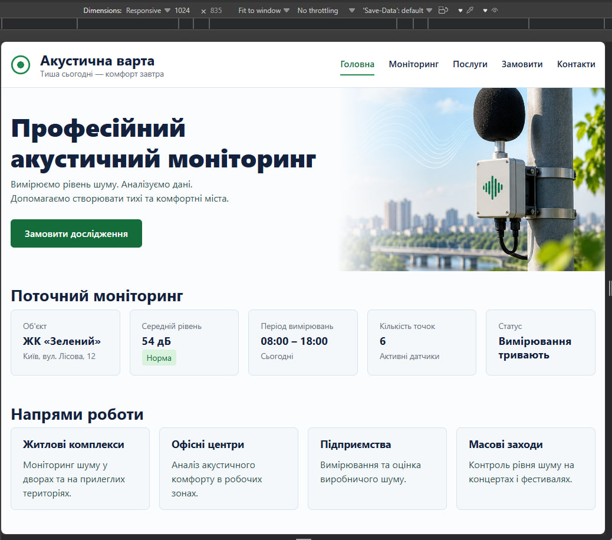
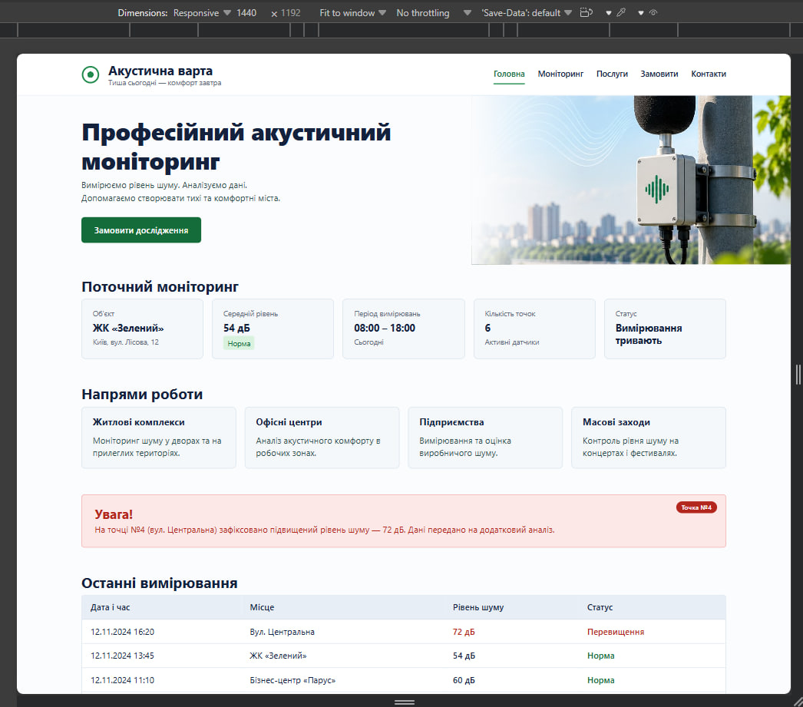

# 🔊 Акустична варта

**Лабораторна робота №3 · Адаптивна верстка за допомогою Flexbox, CSS Grid та SCSS**


Односторінковий сайт компанії з акустичного моніторингу «Акустична варта». Проєкт створено на основі попередніх лабораторних робіт і перетворено на **адаптивний інтерфейс**: стилі перенесено в модульний SCSS, а макет перебудовується під mobile, tablet і desktop.

> **Тема роботи:** «Адаптивна верстка вебсторінки за допомогою Flexbox, CSS Grid та препроцесора SCSS»  
> **Дисципліна:** WEB-програмування  
> **Автор:** Гошовський Дмитро, група КН-41

## 🔗 Живий сайт

**👉 [https://droid2323.github.io/WEB_LAB/lab_3](https://droid2323.github.io/WEB_LAB/lab_3)**


---

## 📸 Скріншоти

Перевірка адаптивності в Chrome DevTools (Device Toolbar).

### 📱 Mobile — 375 px
Одна колонка скрізь, навігація й footer перебудовані у стовпчик, таблиця прокручується всередині власного контейнера.

<p align="center">
  
</p>

### 📲 Tablet — 768 px
Картки в 2 колонки, hero у дві колонки, поля форми по два в ряд, header і footer у рядок.

<p align="center">
  
</p>

### 💻 Small desktop — 1024 px
Моніторинг у 5 колонок, послуги у 4 колонки, форма з двома колонками (поля + опис).

<p align="center">
  
</p>

### 🖥️ Desktop — 1440 px
Контейнер обмежений до 1440 px, hero-зображення виходить до краю екрана.

<p align="center">
  
</p>

---

## ✨ Можливості

- 📐 **Mobile First** — базові стилі для малого екрана, далі розширення через `min-width`.
- 🧱 **Flexbox** для одновимірних компонентів: header, навігація, footer, кнопки, внутрішня структура карток.
- 🧮 **CSS Grid** для двовимірних макетів: hero, сітки карток, форма.
- 🎨 **SCSS-архітектура** з модулями `@use`, змінними, mixins і помірною вкладеністю (≤ 3 рівні).
- 🔤 **Fluid typography** через `clamp()` для заголовків.
- 🧾 **Таблиця без overflow сторінки** — контейнер з `overflow-x: auto`.
- ✅ **Модальне вікно** «Заявку успішно подано» після відправки форми (нативний `<dialog>`).
- ♿ **Доступність:** семантичні теги, `aria-label`, видимий фокус для клавіатури, достатній контраст тексту, підтримка `prefers-reduced-motion`.

---

## 🧰 Технології

| Технологія | Призначення |
| --- | --- |
| HTML5 | семантична розмітка (`header`, `nav`, `main`, `section`, `article`, `aside`, `footer`, `dialog`) |
| CSS3 | Flexbox, Grid, Media Queries, `clamp()`, `min()`, `max()` |
| SCSS (Dart Sass) | змінні, mixins, nesting, модулі `@use` |
| JavaScript | модальне вікно після відправки форми |
| npm | запуск компіляції Sass |

---

## 🗂️ Структура проєкту

```text
lab_3/
├── index.html
├── package.json
├── README.md
├── assets/
│   └── images/
│       └── hero.jpg
├── css/
│   └── main.css            ← результат компіляції SCSS (вручну не редагувати)
├── js/
│   └── main.js             ← модальне вікно після відправки форми
├── scss/
│   ├── _variables.scss     ← кольори, відступи, радіуси, breakpoints
│   ├── _mixins.scss        ← повторювані патерни
│   ├── _base.scss          ← reset, типографіка, img, поля форм
│   ├── _layout.scss        ← container, header, hero, сітки, форма, footer
│   ├── _components.scss    ← brand, nav, кнопка, картки, warning, таблиця, modal
│   └── main.scss           ← точка входу (@use усіх модулів)
└── screenshots/
    ├── 375.png
    ├── 768.png
    ├── 1024.png
    └── 1200.png
```

---

## 🚀 Запуск

**1. Встановити залежності**

```bash
npm install
```

**2. Скомпілювати SCSS у CSS**

```bash
npm run build     # одноразова збірка scss/main.scss → css/main.css
npm run sass      # режим watch: перекомпіляція при кожній зміні
```

**3. Відкрити сторінку**

Відкрити `index.html` у браузері або запустити через розширення **Live Server** у VS Code.

> 💡 **Windows / PowerShell:** якщо `npm` видає помилку про заборону запуску скриптів, використовуйте `npm.cmd install` та `npm.cmd run build`, або виконайте  
> `Set-ExecutionPolicy -Scope CurrentUser -ExecutionPolicy RemoteSigned`.

Альтернатива без npm: розширення **Live Sass Compiler** у VS Code (налаштування вже є в `.vscode/settings.json`) → кнопка *Watch Sass* при відкритому `scss/main.scss`.

---

## 📏 Breakpoints

Підхід **Mobile First**: базові стилі для mobile, нові стани додаються через `min-width`.

| Стан | Ширина | SCSS-змінна | Monitoring | Services | Hero | Форма |
| --- | --- | --- | :---: | :---: | :---: | --- |
| 📱 Mobile | < 768 px | — | 1 колонка | 1 | стек | 1 колонка |
| 📲 Tablet | 768 – 1023 px | `$bp-tablet` | **2** | **2** | 2 колонки | поля по 2 в ряд |
| 💻 Desktop | ≥ 1024 px | `$bp-desktop` | **5** | **4** | 2 колонки | поля + опис поруч |

---

## 🎨 SCSS-архітектура

Точка входу `main.scss` підключає модулі через `@use` (старий `@import` не використовується):

```scss
@use "variables";
@use "mixins";
@use "base";
@use "layout";
@use "components";
```

| Файл | Відповідальність |
| --- | --- |
| `_variables.scss` | кольори, відступи (`$space-*`), радіуси, ширина контейнера, breakpoints, тіні |
| `_mixins.scss` | media-query, центрування, контейнер, адаптивна сітка, поверхня картки |
| `_base.scss` | box-sizing, body, типографіка, зображення, елементи форм, фокус |
| `_layout.scss` | container, header, hero, сітки карток, форма, footer |
| `_components.scss` | brand, навігація, кнопка, картки, badge, warning, таблиця, модальне вікно |

### Mixins

| Mixin | Що робить |
| --- | --- |
| `respond-to($breakpoint)` | обгортає стилі в `@media (min-width: …)` |
| `flex-center($display)` | центрує вміст через Flexbox (`flex` або `inline-flex`) |
| `container` | контейнер сторінки: `min(100% - gutter, max-width)` по центру |
| `responsive-grid($tablet, $desktop, $gap)` | Grid-сітка 1 → N → M колонок |
| `card-surface` | рамка, фон і анімація картки |
| `edge-gutter` | відступ hero від краю екрана до лівого краю контейнера |
| `focus-ring` | видимий контур фокуса для клавіатурної навігації |

Приклад використання:

```scss
.monitoring-grid {
  @include m.responsive-grid(2, 5);   // 1 → 2 → 5 колонок
}

.services-grid {
  @include m.responsive-grid(2, 4);   // 1 → 2 → 4 колонки
}
```

---

## 🧩 Адаптивна поведінка компонентів

| Компонент | Технологія | Поведінка |
| --- | --- | --- |
| Header + навігація | Flexbox | колонка на mobile, рядок з `space-between` від 768 px; пункти меню переносяться (`flex-wrap`) |
| Hero | Grid | стек на mobile → `1.1fr 0.9fr` від 768 px; заголовок через `clamp()`; зображення `object-fit: cover` |
| Поточний моніторинг | Grid | 1 → 2 → 5 колонок |
| Напрями роботи | Grid + Flexbox | 1 → 2 → 4 колонки; всередині картки вертикальний flex |
| Банер попередження | — | займає ширину контейнера, текст переноситься без `nowrap` |
| Таблиця | wrapper | `overflow-x: auto`, `min-width: 640px`; сторінка не стає ширшою за viewport |
| Форма | Grid | 1 колонка → поля по 2 в ряд (768 px) → `2fr 1fr` з полем опису поруч (1024 px) |
| Footer | Flexbox | колонка на mobile, рядок з вирівнюванням по краях від 768 px |

---

## ✅ Відповідність вимогам лабораторної

| № | Вимога | Статус |
| :-: | --- | :-: |
| 1 | HTML-проєкт базується на «Акустична варта» | ✅ |
| 2 | У HTML є `meta viewport` | ✅ |
| 3 | Основні стилі винесені в SCSS | ✅ |
| 4 | Модульна структура `@use`, без `@import` | ✅ |
| 5 | Є окремий `_variables.scss` | ✅ |
| 6 | Є окремий `_mixins.scss` | ✅ |
| 7 | SCSS-змінні для кольорів, spacing і breakpoints | ✅ |
| 8 | Не менше двох mixins (є 7) | ✅ |
| 9 | Вкладеність не глибша за 3 рівні | ✅ |
| 10 | Flexbox мінімум у двох компонентах | ✅ |
| 11 | CSS Grid мінімум у двох сітках | ✅ |
| 12 | Media Queries для mobile / tablet / desktop | ✅ |
| 13 | Hero перебудовується на вузьких екранах | ✅ |
| 14 | Картки monitoring: 1 → 2 → 5 колонок | ✅ |
| 15 | Картки services: 1 → 2 → 4 колонки | ✅ |
| 16 | Таблиця не створює horizontal overflow сторінки | ✅ |
| 17 | Форма на mobile одноколонкова | ✅ |
| 18 | Footer перебудовується на mobile | ✅ |
| 19 | SCSS успішно компілюється у CSS | ✅ |
| 20 | Перевірено через DevTools на 375 / 768 / 1024 / 1200 px | ✅ |

---

## 🔍 Тестування в DevTools

1. Відкрити сторінку, натиснути **F12**.
2. Увімкнути **Device Toolbar** (Ctrl + Shift + M).
3. Перевірити ширини **375 px**, **768 px**, **1024 px** та **1200 px і більше**.
4. Повільно змінювати ширину вікна й простежити, у який момент компоненти перебудовуються.
5. Переконатися, що **горизонтального скролу на рівні `body` немає**.

Результат перевірки ширин 320, 375, 767, 768, 1023, 1024, 1280 і 1651 px: `document.documentElement.scrollWidth` дорівнює ширині viewport на кожній з них, тобто переповнення відсутнє.

---

## Всі інші роботи: **👉 [https://droid2323.github.io/WEB_LAB/](https://droid2323.github.io/WEB_LAB/)**

*Лабораторна робота №3 · WEB-програмування · КН-41 · 2026*