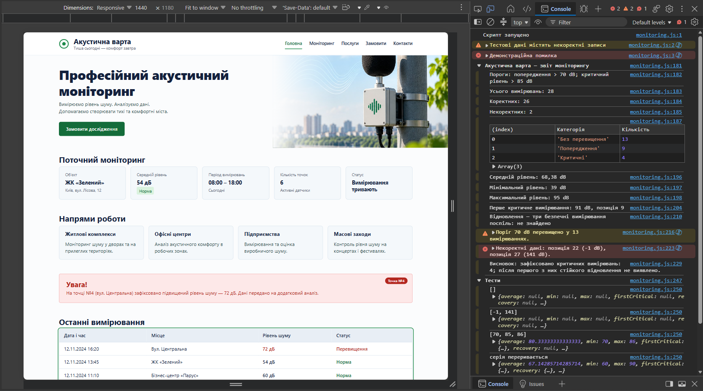
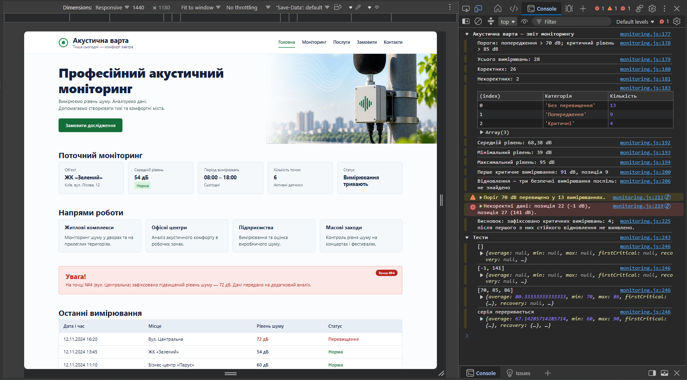
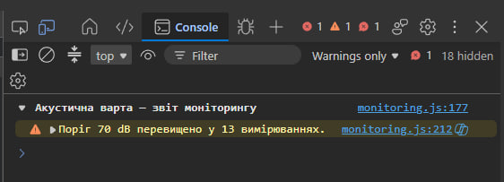
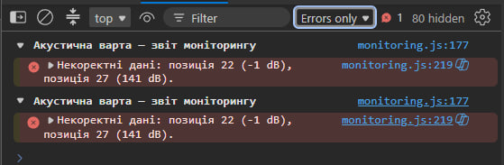
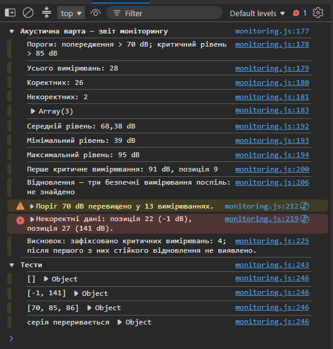
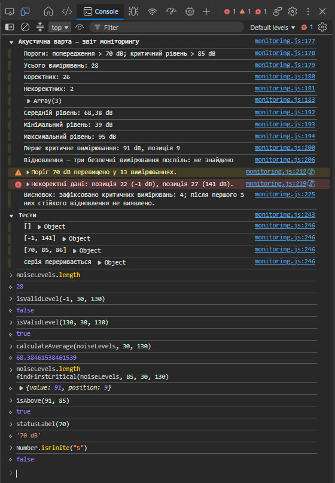
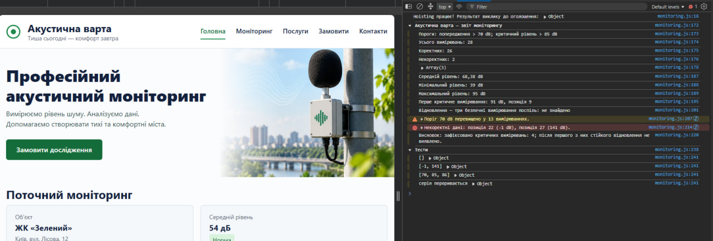
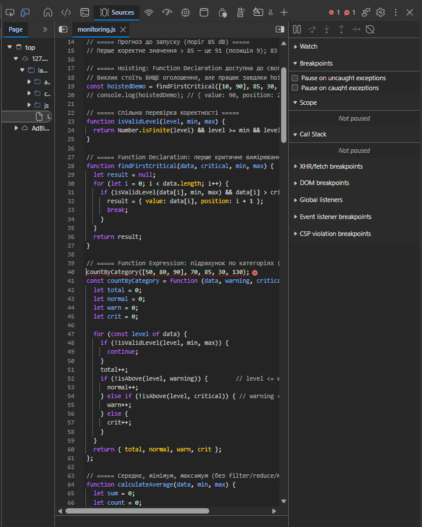

# 🔊 Акустична варта — Аналіз даних (Console)

**Лабораторна робота №4 · Робота з циклами, функціями та функціональними виразами в JavaScript. Консоль браузера.**


Продовження розробки проєкту «Акустична варта». У цій роботі до адаптивного інтерфейсу додано зовнішній JavaScript-файл, який аналізує масив вимірювань рівня шуму, фільтрує некоректні дані, проводить розрахунки та друкує обґрунтований структурований звіт у консолі браузера.

> **Тема роботи:** «Робота з циклами, функціями та функціональними виразами в JavaScript. Консоль браузера.»  
> **Дисципліна:** WEB-програмування  
> **Автор:** Гошовський Дмитро, група КН-41

## 🔗 Живий сайт (Консоль)

**👉 [https://droid2323.github.io/WEB_LAB/lab_4](https://droid2323.github.io/WEB_LAB/lab_4)**  
*(Для перевірки роботи скрипта відкрийте Developer Tools (F12) -> вкладка Console)*

---

## 📸 Виконання завдань (Скріншоти)

Робота з консоллю браузера та демонстрація виконання алгоритмів.


### 1. Фінальний звіт та налаштування консолі (Preserve log)
Звіт згруповано за допомогою `console.group`. Показано загальну статистику, відфільтровані некоректні записи та класифікацію рівнів шуму. Демонстраційні повідомлення видалені перед фінальним релізом. Увімкнено опцію **Preserve log / Keep log**.

<p align="center">
  
</p>

<p align="center">
  
</p>

### 2. Робота з рівнями логування: Фільтр Warnings
Демонстрація фільтрації повідомлень консолі. Відображаються лише попередження (Warnings), зокрема кастомне повідомлення про перевищення порогу у 70 dB.

<p align="center">
  
</p>

### 3. Робота з рівнями логування: Фільтр Errors
Демонстрація фільтрації консолі для відображення лише помилок (Errors). Виведено повідомлення про знайдені некоректні дані у вхідному масиві.

<p align="center">
  
</p>

### 4. Повернення до Default levels та введення команд
Відображення консолі зі стандартними налаштуваннями рівнів. Також показано дозвіл на вставку коду (якщо браузер вимагав `allow pasting`).

<p align="center">
  
</p>

### 5. Виконання JS-виразів у консолі
Перевірка роботи створених функцій вручну через інтерактивний ввід консолі: тестування `isValidLevel`, `calculateAverage`, `findFirstCritical`, виклик стрілкових функцій.

<p align="center">
  
</p>

### 6. Демонстрація Hoisting (Function Declaration)
Успішний виклик функції `findFirstCritical` (або іншої Function Declaration) до рядка її фактичного оголошення в коді. Це підтверджує механізм "підняття" (hoisting) у JavaScript.

<p align="center">
  
</p>

### 7. Демонстрація ReferenceError (Function Expression)
Спроба викликати функціональний вираз (Function Expression, присвоєний у `const`), до його ініціалізації. Очікувано отримано `Uncaught ReferenceError: Cannot access before initialization`. Файл та рядок помилки підсвічено.

<p align="center">
  
</p>

---

## ✨ Можливості та реалізовані алгоритми

- 🔄 **Робота з циклами:**
  - `for...of` — для перебору значень і підрахунку категорій.
  - `for` — для знаходження першого критичного вимірювання (з використанням `break` для оптимізації).
  - `while` — для пошуку періоду відновлення (три безпечні виміри поспіль).
  - `do...while` — для перевірки наявності хоча б одного коректного значення у непорожньому масиві.
- 🎛 **Керування потоком:** використання `continue` для ігнорування фізично неможливих значень (поза межами 30-130 dB).
- 🧩 **Декомпозиція коду:** логіку розділено на окремі функції з чіткою відповідальністю (`isValidLevel`, `calculateAverage` тощо).
- 🧬 **Форми функцій:**
  - *Function Declaration* — для основних розрахунків.
  - *Function Expression* — для специфічних підрахунків (напр., категорій).
  - *Arrow Functions* — для компактних перевірок та форматування рядків.
- 📊 **DevTools API:** використання `console.log`, `console.warn`, `console.error`, `console.group` та `console.groupEnd` для форматування звіту.

---

## 🧰 Технології

| Технологія | Призначення |
| --- | --- |
| HTML5 / CSS3 | Базовий каркас і стилі сторінки з попередньої роботи |
| JavaScript (ES6+) | Обробка даних, цикли, області видимості (scope), hoisting |
| Browser DevTools | Відлагодження, фільтрація логів, інтерактивна взаємодія |

---

## 🗂️ Структура проєкту

```text
lab_4/
├── index.html              ← Інтерфейс (підключено monitoring.js через <script defer>)
├── README.md               ← Опис роботи
├── css/                    ← Стилі з попередніх лабораторних
├── scss/                   ← Вихідні файли стилів
├── js/
│   ├── main.js             ← UI скрипти (модальне вікно)
│   └── monitoring.js       ← ОСНОВНИЙ ФАЙЛ: Алгоритми аналізу шуму
└── screenshots/            ← Скріншоти виконання завдань у консолі
    ├── 1.png
    ├── 2.png
    ├── 3.png
    ├── 4.png
    ├── 5.png
    ├── 6.png
    └── 7.png
```

---

## ✅ Відповідність вимогам лабораторної

| № | Вимога | Статус |
| :-: | --- | :-: |
| 1 | Створено та підключено зовнішній файл `monitoring.js` (з атрибутом defer). | ✅ |
| 2 | Використано цикл `for...of` для базового аналізу. | ✅ |
| 3 | Застосовано `continue` для пропуску некоректних даних. | ✅ |
| 4 | Обчислено середнє, мінімальне та максимальне значення. | ✅ |
| 5 | Використано цикл `for` та `break` для пошуку першого критичного показника. | ✅ |
| 6 | Знайдено момент відновлення за допомогою циклу `while`. | ✅ |
| 7 | Декомпозиція коду на окремі функції з використанням параметрів та `return`. | ✅ |
| 8 | Використано всі 3 типи функцій: Declaration, Expression, Arrow Function. | ✅ |
| 9 | Проведено та задокументовано тест на hoisting та `ReferenceError`. | ✅ |
| 10 | Звіт згруповано за допомогою `console.group`. | ✅ |
| 11 | Використано `console.warn` та `console.error` за призначенням. | ✅ |
| 12 | Очищено демонстраційні повідомлення перед фінальним звітом. | ✅ |

---

## Всі інші роботи: **👉 [https://droid2323.github.io/WEB_LAB/](https://droid2323.github.io/WEB_LAB/)**

*Лабораторна робота №4 · WEB-програмування · КН-41 · 2026*