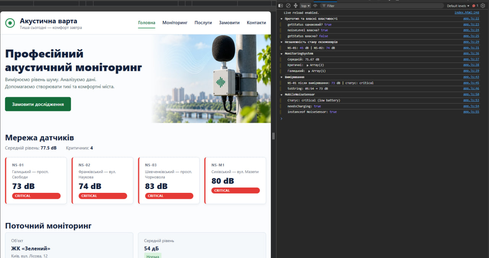

# 🔊 Акустична варта — ООП та DOM

> Лабораторна робота №5 з WEB-програмування: класи, прототипи, наслідування та відображення даних у DOM.

**Студент:** Гошовський Дмитро | **Група:** КН-41 | **Рік:** 2026

---

## 🔗 Живий сайт

**👉 [https://droid2323.github.io/WEB_LAB/lab_5](https://droid2323.github.io/WEB_LAB/lab_5)**

---

## 📸 Скріншот

<p align="center">
  
</p>

---

## 📋 Про проєкт

Розвиток проєкту «Акустична варта» — додано JavaScript-модулі з класами для роботи з сенсорами. Дані відображаються у DOM динамічно: картки датчиків генеруються з масиву об'єктів, показується середній рівень шуму та кількість критичних датчиків.

**Технології:** HTML5 · SCSS · CSS Grid · JavaScript ES Modules · ООП (class, extends, static)

---

## 🗂 Структура проєкту

```
lab_5/
├── index.html
├── package.json
├── assets/
│   └── images/
│       └── hero.jpg
├── css/
│   └── main.css                  # Скомпільований з SCSS
├── js/
│   ├── app.js                    # Головний файл: ініціалізація + DOM
│   ├── models/
│   │   ├── NoiseSensor.js        # Клас NoiseSensor + MobileNoiseSensor
│   │   └── NoiseMeasurement.js   # Клас NoiseMeasurement
│   └── services/
│       └── MonitoringSystem.js   # Клас MonitoringSystem
├── scss/
│   ├── main.scss
│   ├── _variables.scss
│   ├── _mixins.scss
│   ├── _base.scss
│   ├── _layout.scss
│   └── _components.scss
└── screenshots/
    └── 1.png
```

---

## 🧩 Архітектура класів

### `NoiseSensor` — базовий клас сенсора

```js
class NoiseSensor {
  constructor(id, district, location, noiseLevel)

  getStatus()           // "normal" | "warning" | "critical"
  updateNoiseLevel(v)   // оновлює рівень шуму з валідацією
  addMeasurement(m)     // додає об'єкт NoiseMeasurement

  static isValidNoiseLevel(v)  // перевіряє діапазон 0–200
  static fromObject(data)      // фабричний метод
}
```

| Статус | Рівень шуму |
|---|---|
| `normal` | ≤ 55 дБ |
| `warning` | 56 – 70 дБ |
| `critical` | > 70 дБ |

### `MobileNoiseSensor extends NoiseSensor` — мобільний датчик

```js
class MobileNoiseSensor extends NoiseSensor {
  constructor(id, district, location, noiseLevel, batteryLevel)

  needsCharging()  // true якщо batteryLevel < 20
  getStatus()      // override: додає "(low battery)" якщо потрібна зарядка
}
```

### `NoiseMeasurement` — одне вимірювання

```js
class NoiseMeasurement {
  constructor(value, measuredAt = new Date())

  isValid()    // перевіряє діапазон значення
  toString()   // "HH:MM → XX dB"
}
```

### `MonitoringSystem` — система управління датчиками

```js
class MonitoringSystem {
  addSensor(sensor)               // додає з перевіркою типу та унікальності id
  findSensorById(id)              // пошук за id
  getSensorsByDistrict(district)  // фільтр за районом
  getCriticalSensors()            // лише критичні
  getAverageNoiseLevel()          // середнє арифметичне
}
```

---

## 🖥 DOM-відображення

Функція `renderSensorCard(sensor)` динамічно створює картку для кожного датчика:

```js
function renderSensorCard(sensor) {
  const status = sensor.getStatus().split(" ")[0]; // "normal" | "warning" | "critical"
  const card = document.createElement("div");
  card.className = `sensor-card ${status}`;
  // ...
}
```

Функція `renderSensors()` рендерить усі датчики з `MonitoringSystem` і оновлює статистику (середній рівень, кількість критичних).

---

## 🔍 Консольні експерименти (DevTools)

```js
// Прототип та власні властивості
sensorA.getStatus === sensorB.getStatus  // true — метод на прототипі
Object.hasOwn(sensorA, "noiseLevel")     // true — власна властивість
Object.hasOwn(sensorA, "getStatus")      // false — на прототипі

// Незалежність стану
sensorA.updateNoiseLevel(45);
// NS-01: 45 dB | NS-02: 74 dB — стани незалежні

// MobileNoiseSensor
mobile instanceof NoiseSensor  // true
mobile.needsCharging()         // true (batteryLevel: 15 < 20)
mobile.getStatus()             // "critical (low battery)"
```

---

## ✅ Чеклист вимог

| # | Вимога | Статус |
|---|---|---|
| 1 | Клас `NoiseSensor` з конструктором та методами | ✅ |
| 2 | `getStatus()` повертає `normal` / `warning` / `critical` | ✅ |
| 3 | `static isValidNoiseLevel()` та `static fromObject()` | ✅ |
| 4 | `NOISE_LIMITS` заморожено через `Object.freeze()` | ✅ |
| 5 | Клас `NoiseMeasurement` з `isValid()` та `toString()` | ✅ |
| 6 | `addMeasurement()` з перевіркою типу та валідності | ✅ |
| 7 | Клас `MonitoringSystem` з управлінням масивом датчиків | ✅ |
| 8 | `MobileNoiseSensor extends NoiseSensor` з `super()` | ✅ |
| 9 | `needsCharging()` та override `getStatus()` | ✅ |
| 10 | `instanceof` підтверджує ланцюжок наслідування | ✅ |
| 11 | DOM-рендер карток через `createElement` | ✅ |
| 12 | Відображення середнього рівня та кількості критичних | ✅ |
| 13 | Модальне вікно після відправки форми (`<dialog>`) | ✅ |
| 14 | ES Modules (`import` / `export`) | ✅ |

---

## 🚀 Запуск

```bash
npm install
npm run sass    # watch-режим: SCSS → CSS
# або
npm run build   # одноразова збірка
```

Відкрити `index.html` через **Live Server** у VS Code (ES Modules вимагають HTTP-сервер, не просто відкриття файлу).

---

## Всі інші роботи: **👉 [https://droid2323.github.io/WEB_LAB/](https://droid2323.github.io/WEB_LAB/)**

*Лабораторна робота №5 · WEB-програмування · КН-41 · 2026*
