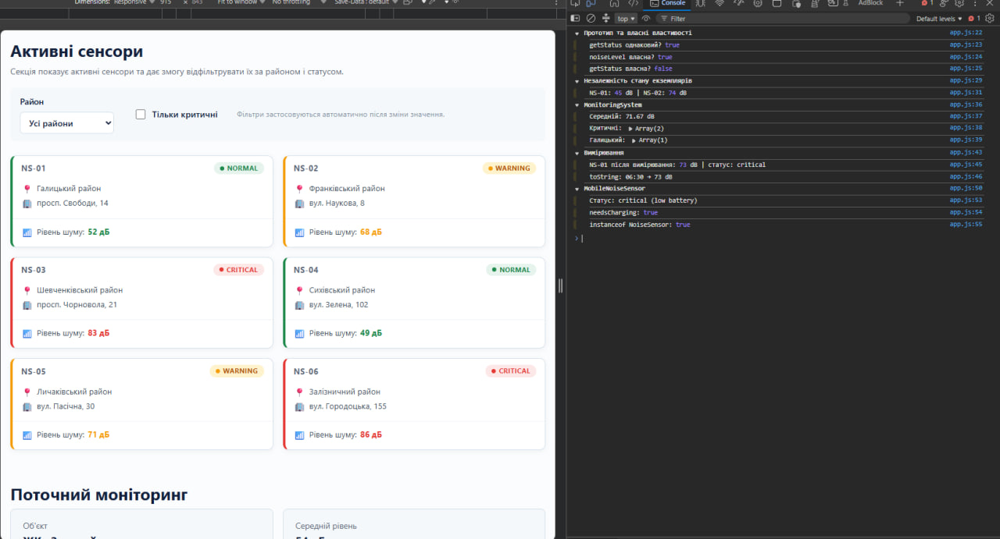

# 🔊 Акустична варта — відображення та фільтрація сенсорів у DOM

> Лабораторна робота №6 з WEB-програмування: робота з DOM — відображення карток сенсорів із JavaScript-масиву та фільтрація за районом і статусом.

**Студент:** Гошовський Дмитро | **Група:** КН-41 | **Рік:** 2026

---

## 🔗 Живий сайт

**👉 [https://droid2323.github.io/WEB_LAB/lab_6](https://droid2323.github.io/WEB_LAB/lab_6)**

---

## 📸 Скріншот

<p align="center">
  
</p>

---

## 📋 Про проєкт

Розвиток проєкту «Акустична варта» — додано секцію «Активні сенсори». JavaScript зчитує масив об'єктів-сенсорів, динамічно створює картки через `createElement` та вставляє їх у DOM. Два фільтри (`select` по районах та `checkbox` «Тільки критичні») оновлюють список у реальному часі без перезавантаження сторінки.

**Технології:** HTML5 · SCSS · CSS Grid · JavaScript (ES Modules) · DOM API

---

## 🗂 Структура проєкту

```
lab_6/
├── index.html
├── package.json
│ 
├── screenshots
│   └── images/s1.png                         # Скріншот секції
├── assets/
│   └── images/
│       └── hero.jpg
├── css/
│   └── main.css                  # Скомпільований з SCSS
├── js/
│   ├── app.js                    # Головний файл: DOM-рендер + фільтри
│   ├── models/
│   │   ├── NoiseSensor.js        # Клас NoiseSensor, MobileNoiseSensor
│   │   └── NoiseMeasurement.js   # Клас NoiseMeasurement
│   └── services/
│       └── MonitoringSystem.js   # Клас MonitoringSystem
└── scss/
    ├── main.scss
    ├── _variables.scss
    ├── _mixins.scss
    ├── _base.scss
    ├── _layout.scss
    └── _components.scss          # + стилі active-sensor-card, sensor-filters
```

---

## 🧩 Що реалізовано в лабораторній 6

### Масив даних сенсорів

```js
const sensorsLab6 = [
  { id: "NS-01", district: "Галицький",      location: "просп. Свободи, 14",   noiseLevel: 52, status: "normal"   },
  { id: "NS-02", district: "Франківський",   location: "вул. Наукова, 8",      noiseLevel: 68, status: "warning"  },
  { id: "NS-03", district: "Шевченківський", location: "просп. Чорновола, 21", noiseLevel: 83, status: "critical" },
  { id: "NS-04", district: "Сихівський",     location: "вул. Зелена, 102",     noiseLevel: 49, status: "normal"   },
  { id: "NS-05", district: "Личаківський",   location: "вул. Пасічна, 30",     noiseLevel: 71, status: "warning"  },
  { id: "NS-06", district: "Залізничний",    location: "вул. Городоцька, 155", noiseLevel: 86, status: "critical" },
];
```

### DOM-функції

| Функція | Що робить |
|---|---|
| `createSensorCard(sensor)` | Створює `<article>` з класами `active-sensor-card--normal/warning/critical`, заголовком, районом, локацією, рівнем шуму |
| `renderActiveSensors(array)` | Очищує `.sensor-list` через `replaceChildren()`, потім вставляє картки через `append()` |
| `applyFilters()` | Читає `districtFilter.value` та `criticalFilter.checked`, фільтрує масив через `.filter()`, викликає `renderActiveSensors()` |

### Обробники подій

```js
districtFilter.addEventListener("change", applyFilters);
criticalFilter.addEventListener("change",  applyFilters);
```

### Логіка фільтрації

```js
const filtered = sensorsLab6.filter(sensor => {
  const matchesDistrict = selectedDistrict === "all" || sensor.district === selectedDistrict;
  const matchesStatus   = !criticalOnly || sensor.status === "critical";
  return matchesDistrict && matchesStatus;
});
```

---

## 🎨 Оформлення статусів

Кожна картка отримує модифікатор BEM — лівий бордер відповідного кольору:

| Статус | Клас | Колір |
|---|---|---|
| normal | `active-sensor-card--normal` | 🟢 `#1f8a4c` |
| warning | `active-sensor-card--warning` | 🟡 `#f59e0b` |
| critical | `active-sensor-card--critical` | 🔴 `#e53935` |

---

## ✅ Чеклист вимог

| # | Вимога | Статус |
|---|---|---|
| 1 | DOM-елементи отримані через `querySelector()` | ✅ |
| 2 | Картки створені через `createElement` | ✅ |
| 3 | Картки додані у DOM через `append()` | ✅ |
| 4 | CSS-клас картки залежить від `status` | ✅ |
| 5 | `normal`, `warning`, `critical` мають різне оформлення | ✅ |
| 6 | Масив сенсорів відфільтровано через `.filter()` | ✅ |
| 7 | Зміна `select` та `checkbox` обробляється через `addEventListener("change")` | ✅ |
| 8 | Фільтр по районах працює | ✅ |
| 9 | Фільтр «Тільки критичні» працює | ✅ |
| 10 | Обидва фільтри працюють одночасно | ✅ |
| 11 | Порожній результат — список просто порожній | ✅ |
| 12 | Стилі секції описані у SCSS (`_components.scss`) | ✅ |

---

## 🚀 Запуск

```bash
npm install
npm run sass    # watch-режим: SCSS → CSS
# або
npm run build   # одноразова збірка
```

Відкрити `index.html` у браузері або через **Live Server** у VS Code.

---

## Всі інші роботи: **👉 [https://droid2323.github.io/WEB_LAB/](https://droid2323.github.io/WEB_LAB/)**

*Лабораторна робота №6 · WEB-програмування · КН-41 · 2026*
