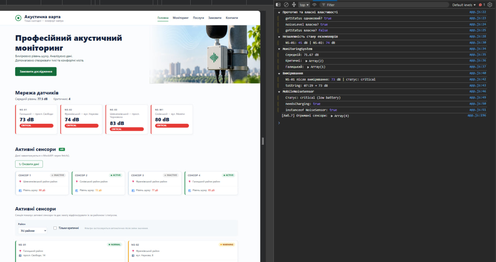
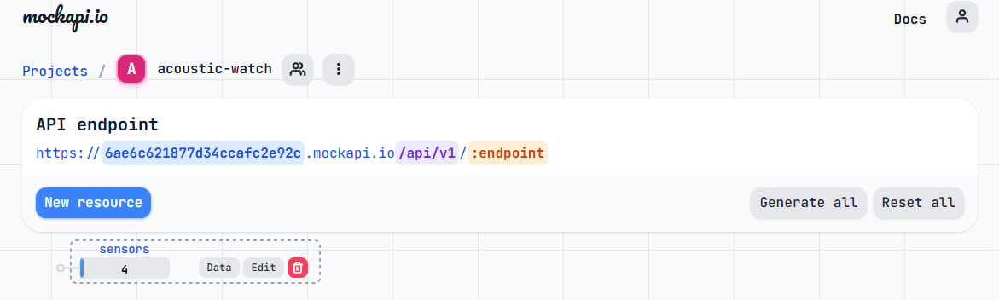

# 🔊 Акустична варта — завантаження даних з публічного API

> Лабораторна робота №7 з WEB-програмування: отримання даних через `fetch()` з MockAPI та відображення на сторінці.

**Студент:** Гошовський Дмитро | **Група:** КН-41 | **Рік:** 2026

---

## 🔗 Живий сайт

**👉 [https://droid2323.github.io/WEB_LAB/lab_7](https://droid2323.github.io/WEB_LAB/lab_7)**

---

## 📸 Скріншоти

<p align="center">
  
</p>

<p align="center">
  
</p>

---

## 📋 Про проєкт

Продовження проєкту «Акустична варта» — додано завантаження даних із зовнішнього REST API. Замість хардкодженого масиву JavaScript тепер отримує список сенсорів через HTTP GET-запит до MockAPI. Після отримання відповіді `renderApiSensors()` динамічно будує картки у DOM.

**Головний ланцюжок:** `MockAPI → fetch() → response.json() → масив sensors → renderApiSensors(sensors) → картки на сторінці`

**Технології:** HTML5 · SCSS · CSS Grid · JavaScript (ES Modules) · Fetch API · MockAPI

---

## 🗂 Структура проєкту

```
lab_7/
├── index.html
├── package.json
├── screenshots/
│   ├── 1.png                     # Скріншот секції API-сенсорів
│   └── 2.png                     # Скріншот MockAPI
├── assets/
│   └── images/
│       └── hero.jpg
├── css/
│   └── main.css                  # Скомпільований з SCSS
├── js/
│   ├── app.js                    # Головний файл: fetch + DOM-рендер
│   ├── models/
│   │   ├── NoiseSensor.js
│   │   └── NoiseMeasurement.js
│   └── services/
│       └── MonitoringSystem.js
└── scss/
    ├── main.scss
    ├── _variables.scss
    ├── _mixins.scss
    ├── _base.scss
    ├── _layout.scss
    └── _components.scss          # + стилі sensor-card-api, api-sensors
```

---

## 🧩 Що реалізовано в лабораторній 7

### API URL

```js
const API_URL = "https://6ae6c621877d34ccafc2e92c.mockapi.io/api/v1/sensors";
```

### Функція завантаження даних

```js
async function loadSensors() {
  try {
    // Перший await: чекаємо HTTP-відповідь
    const response = await fetch(API_URL);

    // Перевіряємо статус відповіді
    if (!response.ok) {
      throw new Error(`HTTP помилка: ${response.status}`);
    }

    // Другий await: конвертуємо JSON → масив JS
    const sensors = await response.json();

    renderApiSensors(sensors);
  } catch (error) {
    console.error("Не вдалося завантажити сенсори:", error);
    showApiError(error.message);
  }
}
```

### Функція відображення сенсорів

```js
function renderApiSensors(sensors) {
  const container = document.querySelector("#sensors-list");
  container.innerHTML = "";

  sensors.forEach((sensor) => {
    const card = document.createElement("article");
    card.className = `sensor-card-api sensor-card-api--${sensor.status}`;
    card.innerHTML = `...`;
    container.append(card);
  });
}
```

### Дані сенсорів у MockAPI

| id | name | district | noiseLevel | status |
|---|---|---|---|---|
| 1 | Сенсор Центр | Галицький | 72 | active |
| 2 | Сенсор Сихів | Сихівський | 58 | active |
| 3 | Сенсор Левандівка | Залізничний | 76 | inactive |
| 4 | Сенсор Підзамче | Шевченківський | 69 | active |

### DOM-функції

| Функція | Що робить |
|---|---|
| `loadSensors()` | Виконує GET-запит, перевіряє `response.ok`, читає JSON через `response.json()`, передає масив у `renderApiSensors()` |
| `renderApiSensors(sensors)` | Очищує `#sensors-list`, для кожного сенсора створює `<article>` через `createElement` і додає через `append()` |
| `showApiLoading()` | Показує індикатор завантаження поки йде запит |
| `showApiError(message)` | Виводить повідомлення про помилку у контейнер |
| `getNoiseClass(level)` | Повертає `low` / `medium` / `high` залежно від рівня шуму |

### Обробник кнопки оновлення

```js
const reloadBtn = document.querySelector("#reload-btn");
if (reloadBtn) reloadBtn.addEventListener("click", loadSensors);
```

---

## 🎨 Оформлення статусів

| Статус | Клас | Лівий бордер |
|---|---|---|
| active | `sensor-card-api--active` | 🟢 `#1f8a4c` |
| inactive | `sensor-card-api--inactive` | ⚪ `#d6e2ec` |

---

## 🔍 Як перевірити роботу

1. Відкрити сторінку через **Live Server** (`http://127.0.0.1:5500`)
2. Прокрутити до секції **«Активні сенсори API»** — картки завантажуються автоматично
3. DevTools → **Console** → рядок `[Лаб.7] Отримані сенсори: Array(4)`
4. DevTools → **Network** → запит `sensors` зі статусом **200** і JSON у вкладці Response

---

## ✅ Чеклист вимог

| # | Вимога | Статус |
|---|---|---|
| 1 | Створено ресурс `sensors` у MockAPI з prefix `/api/v1` | ✅ |
| 2 | Додано 4+ тестових записи з полями `name`, `district`, `noiseLevel`, `status` | ✅ |
| 3 | `const API_URL` оголошено на початку файлу | ✅ |
| 4 | Функція `loadSensors()` оголошена як `async` | ✅ |
| 5 | Перший `await` чекає HTTP-відповідь (`Response`) | ✅ |
| 6 | Перевірка `response.ok` і `response.status` | ✅ |
| 7 | Другий `await response.json()` конвертує тіло у масив | ✅ |
| 8 | `renderApiSensors()` не містить `fetch()` — лише DOM-операції | ✅ |
| 9 | Картки створені через `createElement("article")` і `append()` | ✅ |
| 10 | Обробка помилок через `try/catch` | ✅ |
| 11 | `loadSensors()` викликається при завантаженні сторінки | ✅ |
| 12 | Кнопка «Оновити дані» повторно викликає `loadSensors()` | ✅ |
| 13 | У DevTools → Network видно GET-запит зі статусом 200 | ✅ |

---

## 🚀 Запуск

```bash
npm install
npm run sass    # watch-режим: SCSS → CSS
```

Відкрити `index.html` через **Live Server** у VS Code.

---

## Всі інші роботи: **👉 [https://droid2323.github.io/WEB_LAB/](https://droid2323.github.io/WEB_LAB/)**

*Лабораторна робота №7 · WEB-програмування · КН-41 · 2026*
