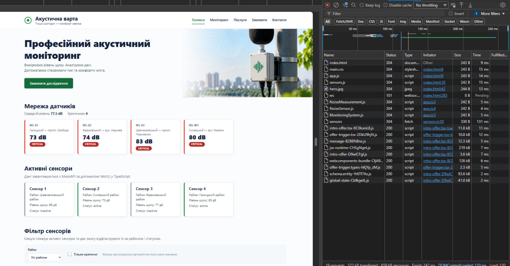
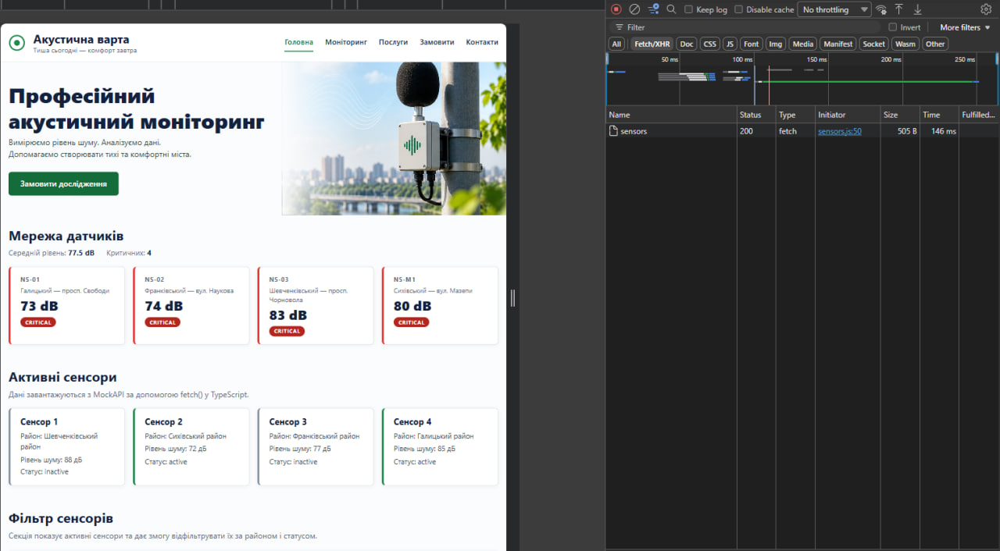

# 🔊 Акустична варта — робота з API на TypeScript

> Лабораторна робота №8 з WEB-програмування: отримання даних з MockAPI через `fetch()` та `async/await`, типізація відповіді за допомогою TypeScript, відображення сенсорів у вигляді карток.

**Студент:** Гошовський Дмитро | **Група:** КН-41 | **Рік:** 2026

---

## 🔗 Живий сайт

**👉 [https://droid2323.github.io/WEB_LAB/lab_8](https://droid2323.github.io/WEB_LAB/lab_8)**

---

## 📸 Скріншоти

<p align="center">
  
</p>

<p align="center">
  
</p>

<p align="center">
  
</p>

---

## 📋 Про проєкт

Продовження проєкту «Акустична варта». У лабораторній №7 дані з MockAPI завантажувались на JavaScript, тепер те саме завдання виконано на **TypeScript**: структура даних описана типом `Sensor`, масив `Sensor[]` передається у функцію відображення, яка створює картки сенсорів у DOM.

**Потік даних:**

```text
MockAPI → fetch() → response.json() → Sensor[] → renderSensors() → HTML-картки
```

**Технології:** HTML5 · SCSS · CSS Grid · JavaScript (ES Modules) · **TypeScript** · Fetch API · MockAPI

---

## 🗂 Структура проєкту

```text
lab_8/
├── index.html
├── package.json
├── tsconfig.json
├── src/
│   └── sensors.ts            ← TypeScript-код (редагується вручну)
├── dist/
│   └── sensors.js            ← JavaScript, який створює компілятор (підключений до HTML)
├── css/
│   └── main.css              ← результат компіляції SCSS
├── js/
│   ├── app.js                ← лаб. 5–6: сітка датчиків, фільтри, модальне вікно
│   ├── models/
│   └── services/
├── scss/
│   ├── main.scss
│   ├── _variables.scss
│   ├── _mixins.scss
│   ├── _base.scss
│   ├── _layout.scss
│   ├── _components.scss
│   └── _sensors.scss         ← картки сенсорів (лаб. 5, 6, 8)
├── assets/images/hero.jpg
└── screenshots/
    ├── 1.png
    └── 2.png
```

`src/sensors.ts → TypeScript compiler → dist/sensors.js → index.html`

---

## 🧩 Що реалізовано

### 1. Interface `Sensor`

```ts
interface Sensor {
  id: string;
  name: string;
  district: string;
  noiseLevel: number;
  status: "active" | "inactive";
}
```

`Sensor[]` — масив об'єктів типу `Sensor`. Поле `status` може мати лише значення `"active"` або `"inactive"`.

### 2. Завантаження даних — `loadSensors()`

```ts
async function loadSensors(): Promise<void> {
  showMessage("Завантаження даних…");

  try {
    const response = await fetch(API_URL);

    if (!response.ok) {
      throw new Error(`Не вдалося завантажити сенсори (HTTP ${response.status})`);
    }

    const sensors: Sensor[] = await response.json();
    renderSensors(sensors);
  } catch (error) {
    console.error("Помилка:", error);
    showMessage("Не вдалося завантажити дані з API. Спробуйте оновити сторінку пізніше.", true);
  }
}
```

### 3. Відображення — `renderSensors(sensors: Sensor[])`

Функція **не звертається до API**, лише створює картки: `div.sensor-card` з назвою, районом, рівнем шуму та статусом. Контейнер типізовано через `document.querySelector<HTMLDivElement>("#sensors")`, перед роботою виконується перевірка на `null`.

Дані з API вставляються через `textContent`, а не `innerHTML`, тому навіть значення з HTML-тегами в назві сенсора відображаються як текст і не виконуються.

### 4. Функції модуля

| Функція | Призначення |
| --- | --- |
| `loadSensors()` | `fetch` → перевірка `response.ok` → `response.json()` → `Sensor[]` → `renderSensors()` |
| `renderSensors(sensors)` | створює картки з масиву `Sensor[]` |
| `showMessage(text, isError)` | повідомлення в контейнері: завантаження, порожній список, помилка |
| `createRow(label, value)` | один рядок картки виду «Район: Галицький» |

### 5. Дані в MockAPI

Endpoint: `https://6ae6c621877d34ccafc2e92c.mockapi.io/api/v1/sensors` (той самий проєкт, що й у лабораторній №7).

| Поле | Тип | Приклад |
| --- | --- | --- |
| `id` | string | `"1"` |
| `name` | string | `"Сенсор Центр"` |
| `district` | string | `"Галицький"` |
| `noiseLevel` | number | `72` |
| `status` | string | `"active"` |

---

## ⚙️ Налаштування TypeScript (`tsconfig.json`)

```json
{
  "compilerOptions": {
    "target": "ES2020",
    "module": "ES2020",
    "strict": true,
    "rootDir": "./src",
    "outDir": "./dist"
  }
}
```

| Параметр | Пояснення |
| --- | --- |
| `target` | яку версію JavaScript створювати після компіляції |
| `module` | формат модулів у згенерованому JavaScript |
| `strict` | суворіша перевірка типів |
| `rootDir` | папка з TypeScript-кодом: `./src` |
| `outDir` | папка для згенерованого JavaScript: `./dist` |

---

## 🎨 Оформлення карток

| Статус | Клас | Лівий бордер |
| --- | --- | --- |
| `active` | `sensor-card--active` | 🟢 зелений |
| `inactive` | `sensor-card--inactive` | ⚪ сірий |

Сітка `#sensors` — CSS Grid (`repeat(auto-fill, minmax(200px, 1fr))`): від 1 колонки на телефоні до 5 на широких екранах. Стилі винесені в `scss/_sensors.scss`.

---

## 🚀 Запуск

```bash
npm install          # sass + typescript
npm run build        # SCSS → CSS та TypeScript → JavaScript
npm run watch:ts     # автокомпіляція TypeScript під час редагування
npm run sass         # автокомпіляція SCSS
```

Окремо: `npx tsc` — одноразова компіляція TypeScript, `npx tsc --watch` — режим спостереження.

Відкрити `index.html` через **Live Server** у VS Code (`script type="module"` не працює при відкритті файлу напряму з диска).

> 💡 **Windows / PowerShell:** якщо `npm` видає помилку про заборону запуску скриптів, використовуйте `npm.cmd install` та `npm.cmd run build`.

> ⚠️ Папка `dist/` з `sensors.js` має бути в репозиторії: GitHub Pages віддає готовий JavaScript і сам TypeScript не компілює.

---

## 🔍 Як перевірити роботу

1. Відкрити сторінку через Live Server, прокрутити до секції **«Активні сенсори»**: картки з'являються після завантаження.
2. DevTools → **Console**: помилок немає.
3. DevTools → **Network** → запит `sensors`: статус **200**, у вкладці Response видно JSON-масив.
4. Перевірка помилки: у `src/sensors.ts` змінити адресу на неіснуючу, виконати `npx tsc` і оновити сторінку. На сторінці з'явиться повідомлення про помилку, а в Console рядок `Помилка: …`. Після перевірки повернути адресу й перекомпілювати.

---

## ✅ Відповідність вимогам лабораторної

| № | Вимога | Статус |
| :-: | --- | :-: |
| 1 | TypeScript підключено як devDependency (`npm install -D typescript`) | ✅ |
| 2 | Створено `tsconfig.json` з потрібними параметрами | ✅ |
| 3 | Вихідний код у `src/sensors.ts`, результат компіляції у `dist/sensors.js` | ✅ |
| 4 | Використано MockAPI з лаб. 7, ресурс `sensors` з не менше ніж 3 записами | ✅ |
| 5 | Структура даних описана через `interface Sensor` | ✅ |
| 6 | HTTP-запит виконується через `fetch()` | ✅ |
| 7 | Використано `async/await` та `Promise<void>` | ✅ |
| 8 | Перевіряється `response.ok`, помилка обробляється в `try/catch` | ✅ |
| 9 | Відповідь типізована: `const sensors: Sensor[] = await response.json()` | ✅ |
| 10 | `renderSensors(sensors: Sensor[])` приймає типізований масив | ✅ |
| 11 | Контейнер типізовано: `querySelector<HTMLDivElement>("#sensors")`, є перевірка на `null` | ✅ |
| 12 | Для кожного сенсора створюється `div.sensor-card` з назвою, районом, рівнем шуму та статусом | ✅ |
| 13 | `loadSensors()` викликається в кінці файлу | ✅ |
| 14 | В `index.html` є `#sensors` і `<script type="module" src="./dist/sensors.js">` | ✅ |
| 15 | `npx tsc` виконується без помилок (режим `strict`) | ✅ |
| 16 | У DevTools немає помилок, запит `/sensors` має статус 200 | ✅ |

---

## Всі інші роботи: **👉 [https://droid2323.github.io/WEB_LAB/](https://droid2323.github.io/WEB_LAB/)**

*Лабораторна робота №8 · WEB-програмування · КН-41 · 2026*
